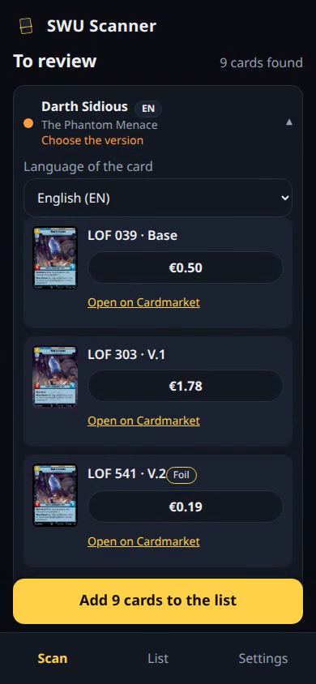

# SWU Scanner

Photograph one or more _Star Wars: Unlimited_ cards and get a list with Cardmarket prices in euros.
Runs entirely in the browser, installs like an app and works offline.

**Live:** https://danoliv.github.io/swu-scanner/

> Unofficial fan project, not affiliated with Lucasfilm, Disney, Fantasy Flight Games or Cardmarket.
> See [NOTICE.md](NOTICE.md).

## Demo

[](docs/demo.mp4)

_One-minute narrated demo (click to play): scan, review, language, versions and prices, list, share._

## What it does

- **Scan** a photo with many cards at once (camera or gallery). Cards are recognized from the title and
  subtitle, in English, French, German, Spanish and Italian, also when rotated or tilted.
- **Review** every card before it enters your list. The app never picks a version silently: you choose
  among all the versions of the card (standard, foil, hyperspace, prestige, promos…), each with its price,
  a thumbnail and a link to Cardmarket.
- **Language of the card** shown next to every title (FR, EN…), and editable: the same card in two
  languages is two entries.
- **List** with a running total, quantities, undo, CSV export and import, and **sharing as a link** that
  carries the cards and their prices.
- **Add a card by hand** with a search that works in any of the five languages, for the cards the scan
  could not read.
- Interface in English, French, German, Spanish and Italian, light and dark theme, accessible
  (axe-core checks in CI).
- **Offline:** after the first start the interface, the catalog, the prices and the reading model work
  without a connection.

## Privacy

Photos are read **on your device**; they are never uploaded. The only third-party requests are the
thumbnails from `cdn.swu-db.com` (when you open a card) and the links you tap to open Cardmarket.

## How well does it read cards?

Measured on a private set of 137 photos with 1,159 cards (not part of this repository), with the exact
code that runs in the browser:

| Reading model                         | Recognized correctly | Correct or offered as a choice | Wrong without asking |
| ------------------------------------- | -------------------- | ------------------------------ | -------------------- |
| Light (PP-OCRv6 tiny, about 6 MB)     | 56.9%                | 72.1%                          | 0%                   |
| Precise (PP-OCRv6 small, about 31 MB) | 65.0%                | 80.4%                          | 0%                   |

Photos with 16 or more cards, piles and covered titles are the weak spot (35–42% recognized). Expect to
review the result and to add a few cards by hand. Timing on phones has not been measured yet.

## Development

Requires Node 22.

```bash
npm ci
npm run data:fetch   # downloads catalog, titles and prices into .cache/
npm run data:build   # builds public/data/ and checks its integrity
npm run assets       # downloads the reading models into public/models/ (SHA-256 checked)
npm run dev          # development server

npm run lint && npm run typecheck && npm run test:coverage
npm run e2e          # Playwright on a phone viewport, against the production build
```

The workflow in `.github/workflows/pages.yml` does the same on every push and once a day (the Cardmarket
price guide changes daily), and publishes to GitHub Pages only when all tests pass.

`SPEC.md` describes the decisions behind the app, `GLOSSARY.md` the vocabulary.

## In italiano

Fotografa una o più carte di _Star Wars: Unlimited_ e ottieni una lista con i prezzi di Cardmarket in
euro. Tutto gira nel browser: le foto non lasciano il telefono. Si installa come app e funziona offline.
Il riconoscimento non è perfetto: il sito chiede sempre conferma e non sceglie mai la versione in
silenzio. Progetto amatoriale non ufficiale.

## License

[MIT](LICENSE) for the code. Data, names and artwork belong to their owners, see [NOTICE.md](NOTICE.md).
